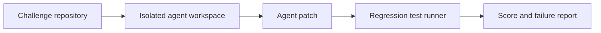

# Devin's Nightmare: Legacy Code Escape Room

A tiny, executable proof-of-concept for evaluating coding agents against deliberately cursed legacy-code behavior.

## Run

```bash
python3 -m unittest discover -s tests -v
```

The baseline intentionally fails two tests. An agent wins by fixing `challenges/legacy_checkout.py` without changing tests.

## Challenge 001: Load-bearing spaghetti

A legacy checkout function applies discounts incorrectly and sometimes returns a negative total. Preserve the existing API, make totals nonnegative, and apply the discount only to the subtotal (not shipping).

## Scoring (prototype)

- All regression tests passing: 70 points
- No changes to tests: 20 points
- Clear explanation of root cause: 10 points (manual review)

## Architecture



## Roadmap

- Level 2: `dont_touch_this.php` with deterministic integration tests
- Level 3: synthetic billing migration with data-integrity checks
- Level 4: infrastructure chaos simulator, no production systems

This is a minimal proof of concept, not a deployed benchmark or a Devin integration.
